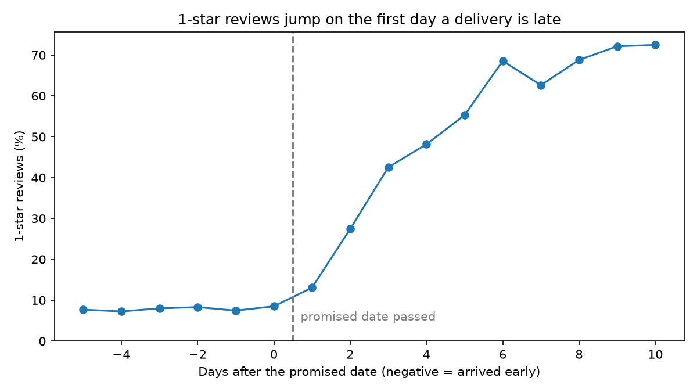

# ช้ากว่าที่สัญญา ไม่ใช่รอนาน: อะไรทำให้ลูกค้า Olist ให้ 1 ดาว

**ลูกค้าลงโทษการผิดสัญญาส่งของ ไม่ใช่การรอนาน** ออเดอร์ที่ส่งถึงภายใน 15 วัน
แต่เลยวันที่สัญญาไว้ ได้ 1 ดาว 24.4% เทียบกับ 6.0% ของออเดอร์ที่ส่งทันสัญญา

## ข้อค้นพบหลัก
- **ส่งช้าทำให้คะแนนตกจริง แต่ไม่มากเท่าที่คิด** ออเดอร์ที่ช้าที่สุด 10% (เกิน 23 วัน)
  ได้ 1 ดาว 37.1% เทียบกับ 6.7% ของออเดอร์ที่เหลือ
- **ระยะทางไม่ใช่ปัญหา วันสัญญาต่างหาก** AM เป็นรัฐที่ส่งนานที่สุด (มัธยฐาน 25.9 วัน)
  แต่แทบไม่เลยวันสัญญา (2.8%) และได้ 1 ดาว (6.9%) น้อยกว่าค่าทั้งประเทศ (9.7%)
  ส่วน AL, MA และ SE เลยวันสัญญา 15–21% และได้ 1 ดาว 15–16%
- **ความไม่พอใจเริ่มตั้งแต่วันแรกที่เลยสัญญา** อัตรา 1 ดาวนิ่งอยู่ที่ 7.5–8.5%
  จนถึงวันที่สัญญา แล้วพุ่งขึ้น: เลย 1 วัน 13%, 2 วัน 27%, 3 วัน 43% แล้วทรงตัวราว 70%



- **เป็นเหตุการณ์สองครั้ง ไม่ใช่ปัญหาเรื้อรัง** การส่งเลยสัญญาพุ่งหลัง Black Friday 2017
  (24 พ.ย. มี 1,139 ออเดอร์ ราว 5 เท่าของวันปกติ) และช่วง ก.พ.–มี.ค. 2018 (เลยสัญญา 14–19%)
  ซึ่งออเดอร์*ไม่ได้*มากกว่าปกติ สาเหตุของครั้งที่สองยังไม่ทราบ

## สิ่งที่ข้อมูลชี้ (สมมติฐาน ไม่ใช่ข้อสรุป)
1. การตั้ง**วันสัญญาให้แม่น**อาจลด 1 ดาวได้มากกว่าการเร่งส่งให้เร็วขึ้น
2. ไม่กี่วันแรกหลังเลยสัญญาสำคัญที่สุด หลังวันที่ 6 การแก้ไขอาจช่วยได้น้อย
3. ควรทดสอบต่อ: แยกความล่าช้าเป็นช่วง ผู้ขาย → ขนส่ง กับ ขนส่ง → ลูกค้า
   และควบคุมผู้ขายกับประเภทสินค้า

## ข้อมูลและขอบเขต
- [ชุดข้อมูล Olist Brazilian E-Commerce](https://www.kaggle.com/datasets/olistbr/brazilian-ecommerce)
  (Kaggle ไฟล์ลงวันที่ 2021-10-01) ไฟล์ข้อมูลดิบ**ไม่ได้**อยู่ใน repo นี้
- ออเดอร์ที่สั่งตั้งแต่ 2017-01-01 ถึงก่อน 2018-09-01 ที่ส่งถึงแล้วและมีรีวิว
  **n = 95,542** (1 แถว = 1 ออเดอร์ ใช้รีวิวล่าสุดของแต่ละออเดอร์)
- ที่มาของ n: 99,441 ออเดอร์ → อยู่ในช่วงวันที่ 99,092 → ส่งถึงแล้ว 96,204 →
  วันที่เป็นไปได้ 96,185 → มีรีวิว 95,542

## วิธีทำ
EDA 6 ขั้น: ตั้งคำถาม → ดูโครงสร้าง → ตรวจคุณภาพ → ล้าง → สำรวจ → สรุป
การตัดสินใจสำคัญ (ใช้มัธยฐานแทนค่าเฉลี่ย, กฎ IQR หา outlier, ไม่ผ่อน 1 วัน)
บันทึกพร้อมหลักฐานไว้ใน [DECISIONS.md](DECISIONS.md)

## วิธีรัน
```bash
uv sync
# ดาวน์โหลดไฟล์จาก Kaggle แล้วแตกไฟล์ไว้ที่ data/raw/olist/
uv run pytest                          # เทสต์ 31 ข้อ
uv run python scripts/build_report.py  # เขียนผลลง reports/
```
รันรายงานสองรอบได้ไฟล์เหมือนกันทุกไบต์

## โครงสร้างโปรเจกต์
```
src/olist_analysis/   load, checks, cleaning, metrics, config
scripts/              build_report.py, load_to_postgres.py
sql/                  primary key และ view delivered_v
notebooks/            01–05 จบที่ EDA เต็มชิ้น
tests/                pytest ของ cleaning, checks, metrics
docs/                 บันทึกข้อค้นพบและ data dictionary
```

## ข้อจำกัด
- **เป็นความสัมพันธ์ ไม่ใช่เหตุและผล** การเลยสัญญากับคะแนนขึ้นลงไปด้วยกัน
  แต่อาจมีปัจจัยอื่น (ผู้ขาย, สินค้า) ที่ทำให้เกิดทั้งสองอย่าง
- **มีลูกค้าที่ไม่อยู่ในข้อมูล:** ออเดอร์ที่ยังไม่ได้รับของ 2,888 รายการ
  (อาจเป็นประสบการณ์ที่แย่ที่สุด) และออเดอร์ที่ไม่มีรีวิว 643 รายการ ถูกตัดออก
  ออเดอร์ที่ไม่มีรีวิวเลยสัญญาบ่อยกว่าราว 3.5 เท่า อัตรา 1 ดาวของกลุ่มที่ช้าจึงน่าจะต่ำกว่าความจริง
- **Right-censoring:** ออเดอร์ที่ช้ามากช่วงท้ายของข้อมูลอาจยังไม่ถึงมือลูกค้า
  เดือนท้าย ๆ จึงดูเร็วกว่าความจริง
- **ลูกค้าซื้อซ้ำน้อย (3.1%)** จึงบอกไม่ได้ว่าการส่งช้าทำให้ลูกค้าเลิกซื้อหรือไม่
- รัฐที่มีออเดอร์ไม่ถึง 100 (AP, RR, AC) ตัวเลขแกว่งได้มาก